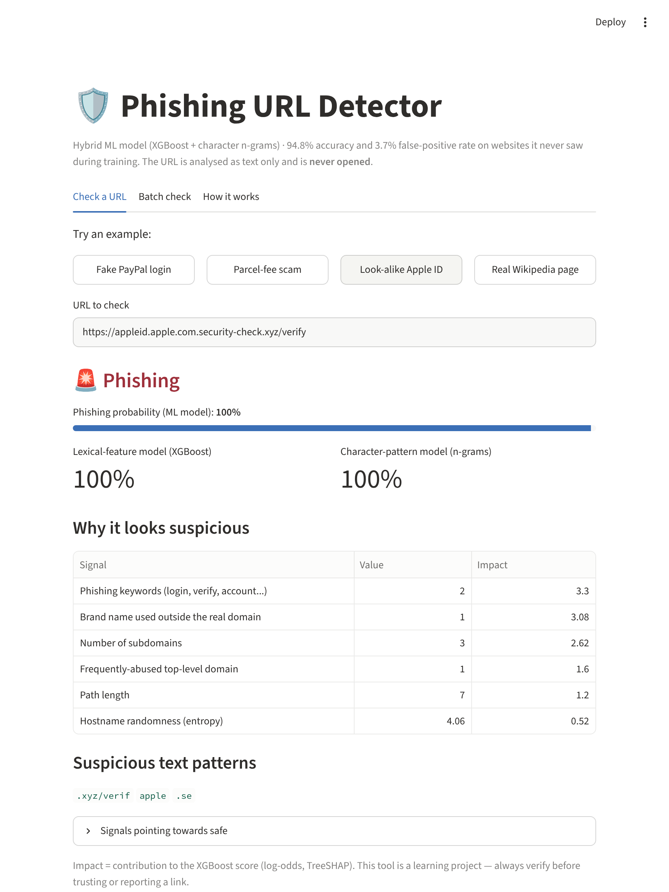
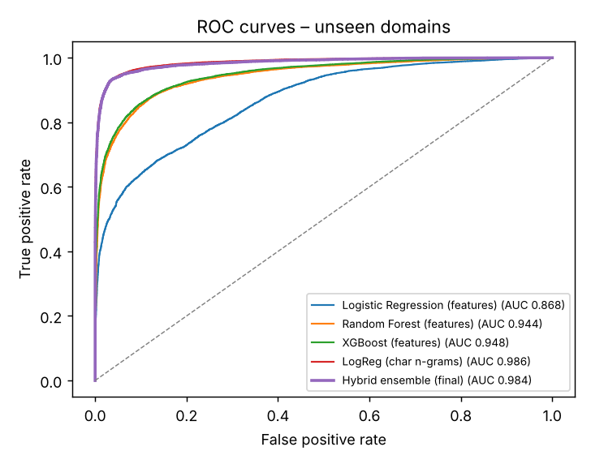
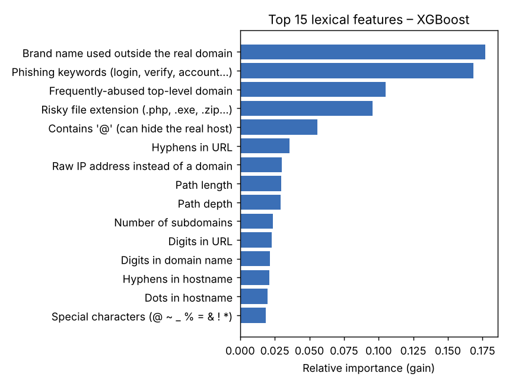

# 🛡️ Phishing URL Detector

An explainable machine-learning tool that flags phishing and malicious URLs **from the URL text alone**. It never opens the link, so it's safe and instant.

**Live demo:** `https://<your-app>.streamlit.app` *(add your link after deploying)*



## Highlights

- **Hybrid model:** XGBoost on 30 hand-crafted lexical features, averaged with logistic regression on character 3–5-grams.
- **Honest evaluation:** the train/test split is **grouped by registered domain**, so every test website is one the model has never seen.
- **94.8% accuracy, 0.984 ROC-AUC and a 3.7% false-positive rate** on 28,043 URLs from unseen domains.
- **Explainable verdicts:** per-URL feature contributions (XGBoost TreeSHAP) and the suspicious text fragments behind them (`paypal`, `.tk/`, `/signin`).
- **Reputation layer:** a top-ranked-domain allowlist cuts false positives on real login pages, without trusting shorteners, free hosting or user-content hosts like `sites.google.com`.
- **Batch mode:** paste or upload up to 1,000 URLs and download the results as CSV.
- **DevSecOps:** GitHub Actions runs unit tests, **Bandit** (static security analysis) and **pip-audit** (dependency CVEs) on every push.

## Results (test set = 28,043 URLs from domains never seen in training)

| Model | Accuracy | Precision | Recall | F1 | ROC-AUC | False-positive rate |
|---|---|---|---|---|---|---|
| Logistic Regression (lexical features) | 0.772 | 0.821 | 0.691 | 0.751 | 0.868 | 14.8% |
| Random Forest (lexical features) | 0.877 | 0.883 | 0.867 | 0.875 | 0.944 | 11.4% |
| XGBoost (lexical features) | 0.879 | 0.888 | 0.866 | 0.877 | 0.948 | 10.7% |
| Logistic Regression (char n-grams) | 0.947 | 0.958 | 0.935 | 0.946 | **0.986** | 4.0% |
| **Hybrid ensemble (final)** | **0.948** | **0.962** | 0.933 | **0.947** | 0.984 | **3.7%** |

With a normal random split the same model scores 95.5% accuracy. Part of that gain is the model recognising domains it has already seen, which is why the grouped split is the number reported above.

<p float="left">
  
  
</p>

## How it works

```
URL ─► normalise (drop scheme, www., trailing /)
      ├─► 30 lexical features ─► XGBoost ──────────┐
      └─► char 3-5-gram TF-IDF ─► LogReg ──────────┼─► average ─► verdict
                                                   │
      registered domain ─► trusted-domain list ────┘ (override → "Likely safe")
```

**Lexical features** (`src/features.py`) include:

- URL, host, path and query length
- Subdomain count, hyphens and digits
- Shannon entropy
- Raw IP host (including hex/integer-encoded IPs), `@` tricks, `//` redirects, punycode (`xn--`)
- Phishing keywords (`login`, `verify`, `account`...)
- **Brand name used outside the registered domain** (`paypal.secure-check.com`)
- Frequently abused TLDs (`.tk`, `.xyz`...), URL shorteners, free-hosting platforms, risky file extensions

**Verdict thresholds:** ≥ 0.8 → *Phishing*, 0.5–0.8 → *Suspicious*, < 0.5 → *Likely safe*.

## Data

| Source | Used as |
|---|---|
| [Malicious URL dataset](https://github.com/faizann24/Using-machine-learning-to-detect-malicious-URLs) (~420k URLs) | benign + malicious |
| [PhishTank](https://www.phishtank.com/) verified-phishing snapshot (~15k URLs) | phishing |
| Top-10k ranked domains ([Alexa snapshot](https://github.com/zer0h/top-1000000-domains)) | benign homepages + trusted-domain list |

**Cleaning** (`src/prepare_data.py`):

- Normalise URLs, drop duplicates and URLs that appear with both labels.
- Keep at most 25 URLs per domain per class, so big sites can't dominate.
- Balance the classes to 69,590 URLs each, giving **139,180 URLs from 80,388 domains**.

### Data pitfalls found and fixed

- **Scheme leakage.** Benign URLs were stored without `http(s)://`, while 46% of PhishTank URLs had `https`. A model could learn "https = phishing", so the scheme is stripped before feature extraction.
- **Trailing-slash leakage.** Benign URLs always contained a `/`, while some phishing URLs didn't, so bare `google.com` scored 100% phishing. Fixed by stripping trailing slashes and adding top-domain homepages as benign examples.
- **Domain memorisation.** Fixed with the grouped train/test split.

## Limitations

- Lexical analysis can't see page content, so it can miss phishing hosted on clean-looking compromised domains, and real login pages on non-allowlisted sites can look suspicious.
- The training data dates from about 2016–2020. Phishing trends change (QR codes, new TLDs, abuse of cloud platforms), so the model needs retraining on fresh feeds.
- URL shorteners are flagged as risky because they hide the destination. Expanding them would need a network request, which this tool deliberately avoids.
- The allowlist is static. A compromised trusted site would be marked safe.

## Run locally

```bash
git clone https://github.com/<you>/phishing-url-detector.git
cd phishing-url-detector
python -m venv .venv && source .venv/bin/activate   # Windows: .venv\Scripts\activate
pip install -r requirements-dev.txt

streamlit run app.py              # uses the pre-trained model in models/

# optional: rebuild the dataset and retrain (~2 minutes)
python -m src.prepare_data
python -m src.train
python -m pytest -q
```

## Deploy (free) on Streamlit Community Cloud

1. Push this repo to GitHub.
2. Go to [share.streamlit.io](https://share.streamlit.io) → **Create app** → choose the repo, branch `main`, file `app.py`.
3. Under *Advanced settings*, choose **Python 3.13**, then click **Deploy**.
4. Paste the app URL at the top of this README and in your CV.

## Project structure

```
├── app.py                  Streamlit UI (single check, batch check, model info)
├── src/
│   ├── features.py         URL normalisation + 30 lexical features
│   ├── prepare_data.py     download, clean, de-duplicate, balance
│   ├── train.py            grouped split, baselines, hybrid model, plots
│   └── model.py            PhishingDetector: scoring, explanations, allowlist
├── models/                 trained XGBoost + n-gram model, metrics, trusted domains
├── reports/                ROC, confusion matrix, feature importance, screenshot
├── tests/                  pytest unit tests
└── .github/workflows/ci.yml  tests + Bandit + pip-audit
```

## Future work

- Add host-based features (domain age via WHOIS, TLS certificate issuer, DNS records) behind an opt-in toggle.
- Retrain on a live feed (PhishTank or OpenPhish) on a schedule and track model drift.
- A browser extension that checks links before you click them.
- Map detections to MITRE ATT&CK **T1566 (Phishing)** and export alerts in a SIEM-friendly format.

---
Built by **Sanjeevani Barua** · MIT License · For learning and research; always verify before trusting or reporting a link.
